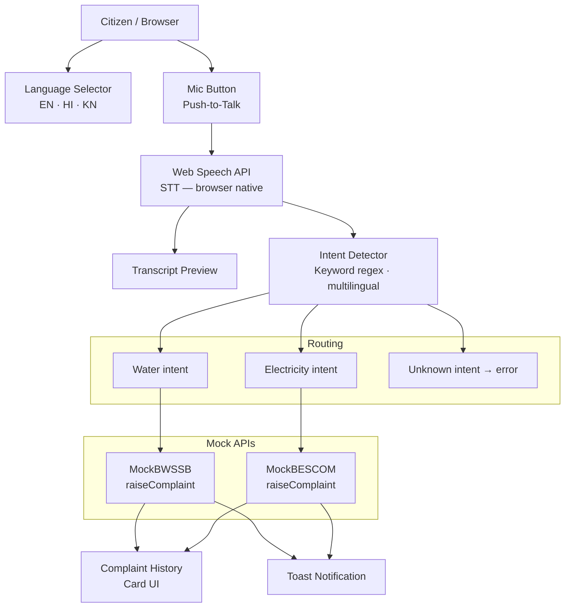

# Architecture Decision Record — Mavericks

**Project:** Mavericks — Bengaluru Civic Complaint Voice Assistant  
**Version:** 1.0  
**Date:** 2026-11-22  
**Skills applied:** `voice-app-architect`, `voice-app-builder`, `frontend-ui`, `ai-architect`

---

## 1. Interaction Model

| Dimension | Decision |
|---|---|
| Who speaks | Citizen (user) → Mavericks bot |
| Turn model | Push-to-talk (click to record, auto-stop on silence) |
| Languages | English (`en-IN`), Hindi (`hi-IN`), Kannada (`kn-IN`) |
| Latency target | Near-real-time (< 2s for routing; 1–2s mock API delay) |
| Platform | Browser (web app, single-page) |
| Session length | Short commands; complaint per session |

---

## 2. Stack Decisions

| Layer | Choice | Reason |
|---|---|---|
| Frontend | Vanilla HTML/CSS/JS (single file) | Zero install, works offline, no build toolchain needed for MVP |
| Speech-to-Text | Web Speech API (`webkitSpeechRecognition`) | Browser-native; supports `en-IN`, `hi-IN`, `kn-IN`; no API key; free |
| Intent detection | Keyword pattern matching (regex, multilingual) | Deterministic, fast, no LLM cost; handles EN/HI/KN script + transliteration |
| Agency routing | In-memory mock (MockBWSSB, MockBESCOM) | Realistic async stubs with simulated latency and 5% failure rate |
| Backend | None (client-side only) | MVP scope doesn't require persistence; reduces infra complexity |
| TTS | None in V1 (text responses only) | Keeps MVP focused; browser `speechSynthesis` can be added in V2 |

---

## 3. Component Architecture



---

## 4. Fallback Ladder

| Provider | Primary | Fallback |
|---|---|---|
| STT | Web Speech API | Show "not supported" banner; link to Chrome/Edge |
| Intent detection | Keyword regex | Prompt user to re-speak with more specific terms |
| BWSSB API | Mock stub | 5% random failure → user-visible error toast + retry |
| BESCOM API | Mock stub | 5% random failure → user-visible error toast + retry |
| Microphone | `getUserMedia` | Error banner with actionable message per error code |

---

## 5. Data Model (client-side only)

No persistent storage in V1. Complaint history is held in the DOM (page session only).

For V2 (persistent backend):
```
complaints
  id            TEXT PRIMARY KEY
  agency        TEXT           -- 'BWSSB' | 'BESCOM'
  transcript    TEXT
  language      TEXT           -- 'en-IN' | 'hi-IN' | 'kn-IN'
  reference_id  TEXT
  status        TEXT
  filed_at      TIMESTAMP
```

---

## 6. API Contract (Mock)

Both mock APIs share the same async interface:

```
raiseComplaint(description: string, language: string)
  → Promise<{
      success: boolean,
      agency: string,
      referenceId: string,
      description: string,
      language: string,
      status: 'Registered',
      message: string,
      estimatedResolution: string,
      helpline: string,
      filedAt: ISO8601 string,
    }>
  throws Error on simulated server failure
```

Real API integration points (V2):
```
POST https://api.bwssb.gov.in/complaints      → BWSSB complaint endpoint
POST https://api.bescom.karnataka.gov.in/complaints  → BESCOM complaint endpoint
```

---

## 7. Architecture Decision Records (ADRs)

### ADR-001: Web Speech API over dedicated STT service

**Context:** Multilingual STT needed for EN/HI/KN. Options: Sarvam Saaras, OpenAI Whisper, Web Speech API.

**Decision:** Web Speech API (browser-native).

**Rationale:** No API keys, no cost, no backend server required. Natively supports `en-IN`, `hi-IN`, `kn-IN`. Sufficient accuracy for short civic complaint utterances.

**Trade-off:** Chrome/Edge only; requires online connection; no custom vocabulary. Acceptable for MVP.

**Consequence:** V2 can swap to Sarvam Saaras for offline/accuracy improvements without changing the UI contract.

---

### ADR-002: Keyword regex over LLM for intent detection

**Context:** Need to route utterances to BWSSB (water) or BESCOM (electricity).

**Decision:** Deterministic keyword regex patterns covering EN/HI/KN script and transliteration.

**Rationale:** No LLM API key needed; deterministic; < 1ms latency; civic vocabulary is bounded and well-known.

**Trade-off:** Cannot handle novel phrasing or mixed-intent utterances. Tie-breaking by keyword hit count handles overlap.

**Consequence:** V2 can replace with an IBM watsonx Granite call if ambiguity becomes a real problem in production.

---

### ADR-003: Single-file application (no build step)

**Context:** MVP for a hackathon/demo context.

**Decision:** Pure HTML/CSS/JS, no framework, no bundler.

**Rationale:** Zero setup; runs by double-clicking the file; works offline after first load; no npm vulnerabilities.

**Trade-off:** Not scalable beyond MVP. V2 should migrate to a React/Vue + FastAPI stack.

---

## 8. Open Questions (V2)

1. **Real agency API credentials** — BWSSB and BESCOM do not expose public REST APIs at time of writing. Integration requires government API portal access or scraping (not recommended).
2. **Persistent complaint history** — add SQLite + FastAPI backend.
3. **TTS response** — add Sarvam Bulbul or browser `speechSynthesis` for audio confirmation.
4. **VAD** — replace push-to-talk with Voice Activity Detection for hands-free use.
5. **Authentication** — link complaints to a citizen profile (Aadhaar / phone OTP).
